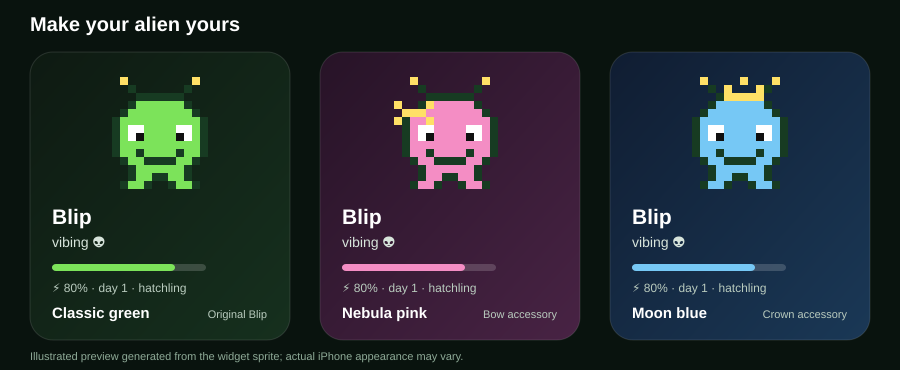
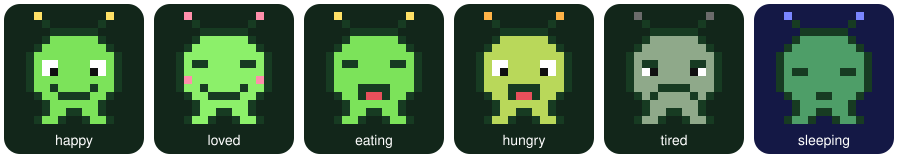

# Alien Pet Widget

A tiny pixel alien for your iPhone Lock Screen and Home Screen, built with [Scriptable](https://scriptable.app/). Its mood follows your battery, the time, and how you care for it. The Lock Screen is the recommended place to start.

*Illustrated preview generated from the widget's pixel sprite. The appearance on your iPhone may vary.*

## What it does

- **Make it yours:** choose Classic green, Nebula pink, or Moon blue, and add a crown or bow.
- **Care for it:** tap the Home Screen widget to pet it, or open the script to Feed snack and Play.
- **Watch it grow:** the Explorer look unlocks after 3 days and 10 interactions; Captain unlocks after 14 days and 50 interactions.
- **See the weather:** optionally show sunglasses, an umbrella, or snowflakes based on your local weather.
- **Check freshness:** Home Screen widgets display when they were last drawn.
- **Use the Lock Screen:** circular, rectangular, and inline layouts are available on iOS 16 and later.
- **Adopt more aliens:** give each widget a pet ID so your Lock Screen and Home Screen can show different pets.
- **Care each day:** complete a daily Pet, Feed, or Play mission, build a forgiving streak, and unlock badges and a star accessory. The care journal keeps the latest 20 actions.
- **Explore a habitat:** the optional large Home Screen widget shows care levels, growth progress, badges, and the latest event.

## Moods

| Mood | When |
|---|---|
| eating ⚡️ | phone is charging |
| sleeping 💤 | 11pm – 6am |
| tired | battery below 20% |
| playing ✨ | played in the last 30 minutes |
| snacking 🍪 | fed a snack in the last 30 minutes |
| loved 💚 | you petted it in the last hour |
| hungry 🔌 | no observed charging or snack for 24 hours |
| happy 👽 | everything else |

The table follows the priority used by the script. For example, charging wins over a recent Play action.
Scriptable only observes charging when the script runs, so the hungry mood cannot know about charging that happened between widget refreshes.

The illustration shows six original expressions; Play and Snack use the happy-eyed open-mouth expression.

## Install

1. Install [Scriptable](https://apps.apple.com/app/scriptable/id1405459188) on your iPhone.
2. In Scriptable, tap **+**, paste in the full [`alien-pet.js`](alien-pet.js) source, and name the script **Alien Pet**.
3. Run it once and pick **Rename** to name your alien. Use **Customize** to pick a skin and accessory, and **Weather** if you want local weather reactions.
4. On your iPhone, long-press the **Lock Screen** → **Customize** → select the Lock Screen → tap the widget area → add a **Scriptable rectangular** widget.
5. Tap the new widget while editing and choose **Alien Pet** as the script. The rectangular layout shows today's care mission. You can also add a circular alien face or an inline status above the clock.

Tapping the widget opens Scriptable, pets that alien, and shows a preview. Run the **Alien Pet** script in Scriptable for Feed snack, Play, customization, the care journal, or to adopt another alien. You do not need a Home Screen widget. If you want one, add a small, medium, or large Scriptable widget and choose **Alien Pet**.

The widget asks for a refresh after 15 minutes, but iOS chooses when it actually updates. The Lock Screen may show an older mission or mood until the next refresh; the Home Screen shows an **updated HH:MM** time.

## Multiple pets and daily care

Run the script → **Your aliens** → **Adopt a new alien**. The menu shows each alien's ID, such as `blip` or `nova`. Choose one there to make it the default pet. To pin a different pet to a widget, edit that Scriptable widget and put its ID in the **Parameter** field, if your Scriptable widget editor offers one. Leave it blank to show the default pet. Tapping a pinned widget pets its own alien.

Each day offers one Pet, Feed, or Play mission. Completing it once earns mission credit; repeating an action is still welcome. Your streak counts days when you interact, and yesterday's streak remains visible until you care for the alien today. Three completed missions unlock the star accessory under **Customize**. Badges mark 10 interactions, a three-day streak, seven missions, and Captain growth. A tiny moon rock appears in the journal every third completed mission. There are no penalties for missed days or old widgets.

The large habitat's affection and fullness are approximate indicators based on the last pet and snack; energy reflects your phone battery. They never reach zero. The rectangular Lock Screen widget shows the mission and streak; the circular one shows the alien and battery, and the inline one shows a short status. You can view all details by running the script.

## Optional weather

Open the script and choose **Weather** to enable local weather reactions. The script first explains where your approximate location will be sent; iOS then asks whether Scriptable may access it. The script saves coordinates rounded to two decimal places (roughly 1 km), and sends them to [Open-Meteo](https://open-meteo.com/) for current conditions. It caches successful data for an hour and limits failed requests to one attempt per hour. Choose **Weather → Turn off weather** to delete the saved coordinates and weather data.

Weather data: [Open-Meteo](https://open-meteo.com/), [CC BY 4.0](https://creativecommons.org/licenses/by/4.0/). Its free API is for non-commercial use.

## Security and privacy

This script reads battery and charging status, uses the current time, and saves pet names, interaction times, journal entries, and settings in Scriptable's local storage. It does not read contacts, photos, messages, or passwords, and it does not download or run remote code. The weather request to Open-Meteo is its only network call, and weather is off until you choose to enable it.

When weather is on, the rounded coordinates are sent to Open-Meteo over HTTPS. [Open-Meteo says](https://open-meteo.com/en/terms) its request logs may contain coordinates and are deleted after 90 days. iOS grants location access to Scriptable as an app, so other scripts you choose to run in Scriptable can use that permission too. Turning weather off removes the saved coordinates from this script; to revoke Scriptable's iOS location permission too, use **Settings → Privacy & Security → Location Services → Scriptable**.

Widget taps open this script through a Scriptable link. A link can trigger the **Pet** action for a selected pet, which only changes that pet's local interaction state. Feed, Play, renaming, customization, and weather settings require the in-app menu. Review the source before installing or updating any Scriptable script, since Scriptable executes the JavaScript you paste into it.

## Lock Screen

On an iPhone running iOS 16 or later, long-press the Lock Screen, tap **Customize**, select the Lock Screen, tap the widget area, and add a Scriptable widget. Choose **Alien Pet** as its script. Circular, rectangular, and inline layouts are supported. Preview each layout from **Preview widget** in Scriptable. Lock Screen colors can change with your wallpaper and tint. Scriptable's previews are estimates; check the layout on the phone after installing.

## Update an existing iPhone install

Open the [latest script source](alien-pet.js) on your iPhone and copy the full source. In Scriptable, open your existing **Alien Pet** script, select its old code, paste the new code, and save it under the same name. Run it once in Scriptable to migrate your original pet into `alien-pets.json`; the previous `alien-pet.json` remains untouched as a backup. Your saved name, birthday, and interaction history are preserved. If a widget does not update immediately, open the script once and wait for iOS to refresh it. See [CHANGELOG.md](CHANGELOG.md) for release notes.

### Troubleshooting

- **Widget is blank:** run the script in Scriptable first, then confirm the widget's selected script is **Alien Pet**.
- **A different alien appears:** check the widget's Parameter ID or choose a new default under **Your aliens**. Unknown IDs fall back to the default pet.
- **Mission looks old:** iOS controls widget refreshes. Run the script to see the current state, then allow time for the Lock Screen to update.
- **Weather is missing:** weather is optional for each pet. Select the pet under **Your aliens**, then choose **Weather** and check Scriptable's location permission.
- **Lock Screen text is cramped:** try the rectangular layout and a short pet name; iOS wallpaper tint and widget sizing can vary.

## Development

Run `node --test tests/widget.test.js` to check Home Screen, Lock Screen, multiple pets, migration, care, and weather flows without an iPhone. Regenerate the feature illustration with `node scripts/render-doc-preview.js`. These checks use a Scriptable mock; final layout, widget Parameter availability, and tap behavior still need a test on an iPhone. The current update has not yet been tested on a phone.

## License

MIT — see [LICENSE](LICENSE).

How this was built: [JOURNEY.md](JOURNEY.md)
