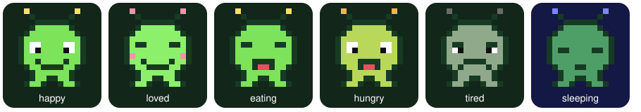

# Alien Pet Widget

A tiny pixel alien that lives on your iPhone home screen. Its mood follows your phone.

| Mood | When |
|---|---|
| eating ⚡️ | phone is charging |
| sleeping 💤 | 11pm – 6am |
| tired | battery below 20% |
| loved 💚 | you petted it in the last hour |
| hungry 🔌 | not charged for 24 hours |
| happy 👽 | everything else |

You can choose **Classic green**, **Nebula pink**, or **Moon blue**, then add a crown or bow. Pet, Feed snack, and Play change the alien's expression for a while. Interactions and age unlock the Explorer stage after 3 days and 10 interactions, then Captain after 14 days and 50 interactions.

Weather reactions are optional. Enable **Weather** from the script's menu on your iPhone and allow Scriptable to use your location. The widget saves an approximate location (rounded to about 1 km), checks [Open-Meteo](https://open-meteo.com/) at most once an hour, and shows sunglasses, an umbrella, or snowflakes when appropriate. Turn Weather off from the same menu to remove its saved location and weather data. The free Open-Meteo API is for non-commercial use; weather data is provided by Open-Meteo under CC BY 4.0.

## Install

1. Install [Scriptable](https://apps.apple.com/app/scriptable/id1405459188) (free) on your iPhone.
2. In Scriptable, tap **+**, paste in [`alien-pet.js`](alien-pet.js) and name it **Alien Pet**.
3. Run it once and pick **Rename** to name your alien. Use **Customize** to pick a skin and accessory, and **Weather** if you want local weather reactions.
4. Long-press your home screen → **+** → **Scriptable** → add a small or medium widget.
5. Long-press the widget → **Edit Widget** → Script: **Alien Pet**, When Interacting: **Run Script**.

Tap the Home Screen widget to pet your alien. Open the **Alien Pet** script in Scriptable for Feed snack, Play, Customize, Weather, and previews. The small and medium widgets show the time they were last drawn. iOS decides when widgets refresh, so this may be later than the requested 15 minutes.

## Lock Screen

On an iPhone running iOS 16 or later, long-press the Lock Screen, tap **Customize**, select the Lock Screen, tap the widget area, and add a Scriptable widget. Choose **Alien Pet** as its script. Circular, rectangular, and inline layouts are supported. Preview each layout from **Preview widget** in Scriptable. Lock Screen colors can change with your wallpaper and tint.

## Update an existing iPhone install

Open [alien-pet.js](alien-pet.js) on your iPhone and copy the full source. In Scriptable, open your existing **Alien Pet** script, select its old code, paste the new code, and save it under the same name. Your saved name, birthday, and petting history remain in Scriptable's `alien-pet.json`. If the Home Screen widget does not update immediately, open the script once and wait for iOS to refresh the widget.

## License

MIT. See [LICENSE](LICENSE).

How this was built: [JOURNEY.md](JOURNEY.md)
