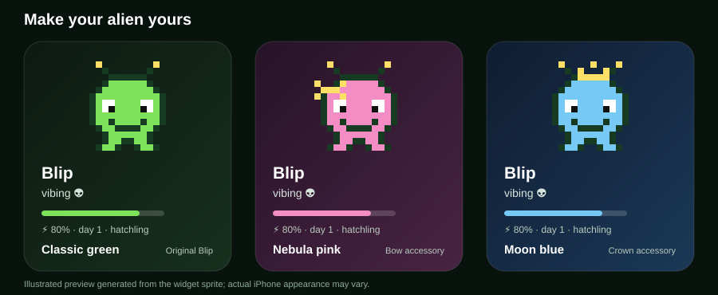

# Alien Pet Widget

A tiny pixel alien for your iPhone Home Screen and Lock Screen, built with [Scriptable](https://scriptable.app/). Its mood follows your battery, the time, and how you care for it.

*Illustrated preview generated from the widget's pixel sprite. The appearance on your iPhone may vary.*

## What it does

- **Make it yours:** choose Classic green, Nebula pink, or Moon blue, and add a crown or bow.
- **Care for it:** tap the Home Screen widget to pet it, or open the script to Feed snack and Play.
- **Watch it grow:** the Explorer look unlocks after 3 days and 10 interactions; Captain unlocks after 14 days and 50 interactions.
- **See the weather:** optionally show sunglasses, an umbrella, or snowflakes based on your local weather.
- **Check freshness:** Home Screen widgets display when they were last drawn.
- **Use the Lock Screen:** circular, rectangular, and inline layouts are available on iOS 16 and later.

## Moods

| Mood | When |
|---|---|
| eating ⚡️ | phone is charging |
| sleeping 💤 | 11pm – 6am |
| tired | battery below 20% |
| playing ✨ | played in the last 30 minutes |
| snacking 🍪 | fed a snack in the last 30 minutes |
| loved 💚 | you petted it in the last hour |
| hungry 🔌 | not charged for 24 hours |
| happy 👽 | everything else |

The table follows the priority used by the script. For example, charging wins over a recent Play action.

## Install

1. Install [Scriptable](https://apps.apple.com/app/scriptable/id1405459188) on your iPhone.
2. In Scriptable, tap **+**, paste in the full [`alien-pet.js`](alien-pet.js) source, and name the script **Alien Pet**.
3. Run it once and pick **Rename** to name your alien. Use **Customize** to pick a skin and accessory, and **Weather** if you want local weather reactions.
4. Long-press your home screen → **+** → **Scriptable** → add a small or medium widget.
5. Long-press the widget → **Edit Widget** → Script: **Alien Pet**, When Interacting: **Run Script**.

Tapping the widget opens Scriptable, pets your alien, and shows a preview. Open the **Alien Pet** script in Scriptable for the other actions. iOS decides when widgets refresh, so the Home Screen may show the previous mood for a while after an action; check the **updated HH:MM** time on the widget.

## Optional weather

Open the script and choose **Weather** to enable local weather reactions. The script first explains where your approximate location will be sent; iOS then asks whether Scriptable may access it. The script saves coordinates rounded to two decimal places (roughly 1 km), and sends them to [Open-Meteo](https://open-meteo.com/) for current conditions. It caches successful data for an hour and limits failed requests to one attempt per hour. Choose **Weather → Turn off weather** to delete the saved coordinates and weather data.

Weather data: [Open-Meteo](https://open-meteo.com/), [CC BY 4.0](https://creativecommons.org/licenses/by/4.0/). Its free API is for non-commercial use.

## Security and privacy

This script reads battery and charging status, uses the current time, and saves your pet's name, interaction times, and settings in Scriptable's local storage. It does not read contacts, photos, messages, or passwords, and it does not download or run remote code. The weather request to Open-Meteo is its only network call, and weather is off until you choose to enable it.

When weather is on, the rounded coordinates are sent to Open-Meteo over HTTPS. [Open-Meteo says](https://open-meteo.com/en/terms) its request logs may contain coordinates and are deleted after 90 days. iOS grants location access to Scriptable as an app, so other scripts you choose to run in Scriptable can use that permission too. Turning weather off removes the saved coordinates from this script; to revoke Scriptable's iOS location permission too, use **Settings → Privacy & Security → Location Services → Scriptable**.

Widget taps open this script through a Scriptable link. A link can trigger the **Pet** action, which only changes the pet's local interaction state. Feed, Play, renaming, customization, and weather settings require the in-app menu. Review the source before installing or updating any Scriptable script, since Scriptable executes the JavaScript you paste into it.

## Lock Screen

On an iPhone running iOS 16 or later, long-press the Lock Screen, tap **Customize**, select the Lock Screen, tap the widget area, and add a Scriptable widget. Choose **Alien Pet** as its script. Circular, rectangular, and inline layouts are supported. Preview each layout from **Preview widget** in Scriptable. Lock Screen colors can change with your wallpaper and tint.

## Update an existing iPhone install

Open [alien-pet.js](alien-pet.js) on your iPhone and copy the full source. In Scriptable, open your existing **Alien Pet** script, select its old code, paste the new code, and save it under the same name. Your saved name, birthday, and petting history remain in Scriptable's `alien-pet.json`. If the Home Screen widget does not update immediately, open the script once and wait for iOS to refresh the widget.

## Development

Run `node --test tests/widget.test.js` to check the script's Home Screen, Lock Screen, petting, and weather flows without an iPhone. Regenerate the feature illustration with `node scripts/render-doc-preview.js`. These checks use a Scriptable mock; final layout and tap behavior still need a test on an iPhone.

## MIT License

Copyright (c) 2026 sharindanic

Permission is hereby granted, free of charge, to any person obtaining a copy of this software and associated documentation files (the "Software"), to deal in the Software without restriction, including without limitation the rights to use, copy, modify, merge, publish, distribute, sublicense, and/or sell copies of the Software, and to permit persons to whom the Software is furnished to do so, subject to the following conditions:

The above copyright notice and this permission notice shall be included in all copies or substantial portions of the Software.

THE SOFTWARE IS PROVIDED "AS IS", WITHOUT WARRANTY OF ANY KIND, EXPRESS OR IMPLIED, INCLUDING BUT NOT LIMITED TO THE WARRANTIES OF MERCHANTABILITY, FITNESS FOR A PARTICULAR PURPOSE AND NONINFRINGEMENT. IN NO EVENT SHALL THE AUTHORS OR COPYRIGHT HOLDERS BE LIABLE FOR ANY CLAIM, DAMAGES OR OTHER LIABILITY, WHETHER IN AN ACTION OF CONTRACT, TORT OR OTHERWISE, ARISING FROM, OUT OF OR IN CONNECTION WITH THE SOFTWARE OR THE USE OR OTHER DEALINGS IN THE SOFTWARE.

See [LICENSE](LICENSE) for the standalone license file.

How this was built: [JOURNEY.md](JOURNEY.md)
